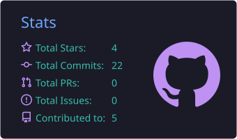
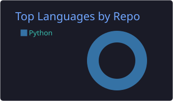
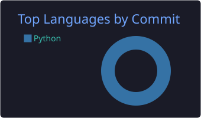

# 👋 Hi, I'm Ethical Hacker

### 🎓 Ethical Hacker • Cybersecurity Researcher • Penetration Tester 🛡️

  
  
  

---

# 💫 About Me

- 🛡️ Ethical Hacker
- 🔐 Cybersecurity Researcher
- 💻 Penetration Tester
- 🐍 Python Developer
- 🌐 OSINT Enthusiast
- 🐧 Linux Enthusiast
- ☁️ Cloud & Automation
- 🤖 AI + Cybersecurity
- 🚀 Founder of **Vishal Infosec AI**

---

# 🌐 Connect With Me

---

# 💻 Tech Stack

### Languages

### Frameworks & Tools

---

# 🚀 Featured Projects

| Project | Description |
|----------|-------------|
| 📞 Phone Lookup CLI | Phone Number Intelligence Tool |
| 🤖 VAGABOND OSINT | Telegram OSINT Bot |
| 🔍 Admin Panel Finder | High-speed Admin Panel Scanner |
| 🛡️ Vishal Infosec AI | Cybersecurity Learning Platform |

---

# 📊 GitHub Stats

<!--
  These cards are generated by the GitHub Action in .github/workflows/profile-summary-cards.yml
  and saved inside this repo (profile-summary-card-output folder), so there is no Vercel
  or rate-limit problem. Run the workflow once (Actions tab -> Run workflow) to create them.
-->

  

  
  

---

# 🔥 GitHub Streak

---

# 📈 Contribution Graph

---

# 📚 Currently Learning

- 🤖 AI for Cybersecurity
- ☁️ Cloud Security
- 🌐 Web Application Security
- 🔍 Advanced OSINT
- 🐍 Python Automation
- ⚔️ Red Team Operations

---

# 🎯 Interests

- Ethical Hacking
- Penetration Testing
- Malware Analysis
- Reverse Engineering
- Digital Forensics
- Threat Intelligence
- Security Automation
- Open Source Projects

---

# ☕ Support My Work

---

# 📫 Contact

📧 **Email:** ethicalhackers741@gmail.com

🌍 **Website:** https://vishalinfosec.in

☕ **Buy Me a Coffee:** https://buymeacoffee.com/vishal.infosec.ai

---

⭐ **Thanks for visiting my profile!** ⭐

